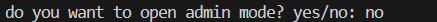
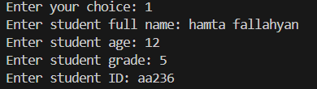
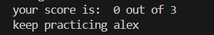

# python School Management System


A simple school management system built with Python.

## Table of contents

- [Features](#features)
- [Project Structure](#project-structure)
- [Requirements](#requirements)
- [Installation](#installation)
- [Environment Setup](#environment-setup)
- [Usage](#usage)
- [Example Output](#example-output)
- [Screenshot](#screenshot)
- [Roadmap](#roadmap)
- [Contributing](#contributing)
- [License](#license)
- [Author](#author)


## Features

- Student Management
    - Adds new students
    - Shows student information
    - Finds students by ID
    - Removes students from the school
    - Changes student grades
- Teacher Management
    - Adds new teachers
    - Stores teacher names and subjects
    - Shows assigned students
- Classroom Management
    - Creates classrooms
    - Assigns teachers to classrooms
    - Assigns students to classrooms
    - Shows classroom information
- Score Management
    - Adds scores to students
    - Shows student scores
    - Calculates average scores
- School Management
    - Shows all students
    - Shows all teachers
    - Shows all classrooms
    - Prevents duplicate student IDs

## Project Structure

```text

school-management/
│   .env.example
│   .envy
│   .gitignore
│   final_SmartCoders_py_school.py
│   README.md
│   requirements.txt
│
├───gifs
│       quiz-demo.gif
│
├───pictures
│       1.png
│       2.png
│       3.png
│
└───
```

### File description

| file | description |
| :--- | :--- |
| `main.py` | Main file used to run the school management system |
| `.gitignore` | Tells Git which files should not be tracked |
| `README.md` | Contains the project documentation |
| `pictures/1.png` | screenshot of the game start |
| `pictures/2.png` | screenshot of the quiz section |
| `pictures/3.png` | screenshot of the quiz section |
| `gifs/` | stores demo GIF files|
| `gifs/demo.gif` | shows the project demo|


## Requirements

Before running, make sure you have:

- `Python 3`
- `A code editor` (optional)

## Installation

1. Open a terminal in the project folder.
2. Check that Python is installed.

```bash
python --version
```

3. Run the program.

```bash
python main.py
```

## Environment Setup

No extra packages or environment variables are needed.

Make sure Python 3 is installed on your computer.

## Usage

1. Open a terminal in the project folder.
2. Run the program.

```bash
python main.py
```

3. Choose an option from the menu.
4. Add students, teachers, and classrooms.
5. Assign teachers and students to classrooms.
6. Add scores to students.
7. View student information and average scores.
8. Choose `12` to exit the program.

## Example Output

```text
=========== School Management Menu ===========
1. Add student
2. Add teacher
3. Add classroom
4. Assign teacher to classroom
5. Assign student to classroom
6. Add score to student
7. Show student info
8. Show all students
9. Show all teachers
10. Show all classrooms
11. Remove student from school
12. Exit
==============================================

Enter your choice: 1
Enter student full name: Alex Smith
Enter student age: 15
Enter student grade: 9
Enter student ID: 1001

Student Alex Smith added to the school.
```

## Screenshot

### Main Menu



### Student Information



### Final Result 



## Demo


## Roadmap

- [x] Add students and teachers
- [x] Create classrooms
- [x] Assign students and teachers to classrooms
- [x] Add student scores
- [x] Calculate average scores
- [x] Show school information
- [x] Remove students from the school
- [ ] Save data to a file
- [ ] Add input validation
- [ ] Add more features

## Contributing


## License

## Author

Created by [Hamta](https://github.com/hamta-fallahyan)

